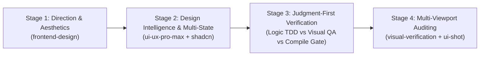

# ⚡ Hyperpowers

**The Full-Stack Agent Engineering & Visual Experience Framework**

Hyperpowers is the comprehensive software engineering and visual design framework for AI coding agents. It unites rigorous backend discipline—test-driven development, causal root-cause debugging, hybrid plan execution, and living architecture memory—with anti-cliché visual design intelligence and zero-leak, multi-viewport visual testing.

---

## Table of Contents

- [Core Innovations](#core-innovations)
- [The 4-Stage Frontend UI/UX Pipeline](#the-4-stage-frontend-uiux-pipeline)
- [The 22-Skill Suite](#the-22-skill-suite)
- [Installation Across Harnesses](#installation-across-harnesses)
  - [Google Antigravity](#google-antigravity)
  - [Claude Code](#claude-code)
  - [OpenAI Codex](#openai-codex)
  - [Cursor & Windsurf](#cursor--windsurf)
  - [Gemini CLI](#gemini-cli)
  - [GitHub Copilot CLI](#github-copilot-cli)
  - [Hermes Agent](#hermes-agent)
  - [Muse](#muse)
  - [Pi](#pi)
  - [Devin, OpenCode, Qwen, Grok, Factory Droid](#other-harnesses)
- [The Zero-Idle Subagent Invariant](#the-zero-idle-subagent-invariant)
- [Living Agent Documentation & Ideas Backlog](#living-agent-documentation--ideas-backlog)
- [Visual Verification (`ui-shot.cjs`)](#visual-verification-ui-shotcjs)
- [Telemetry & Privacy](#telemetry--privacy)
- [Lineage & License](#lineage--license)

---

## Core Innovations

1. **Full-Stack Completeness**: Eliminates the false dichotomy between backend algorithmic correctness and visual user experience.
2. **Anti-Cliché Design Intelligence**: Strictly bans generic purple-to-cyan SaaS gradients (`from-indigo-500 to-teal-400`), the "Lucide-icon-in-a-gray-box" card monoculture, pastel "Trust-Me" badges, tracked-out ALL-CAPS eyebrow labels, and robotic buzz-copy. Anchors interfaces in authentic domain vernacular.
3. **Multi-Viewport Visual QA**: Self-contained, cross-platform CDP snapshot engine (`scripts/ui-shot.cjs`) that audits layouts on Mobile (375px), Tablet (768px), and Desktop (1280px) viewports with zero process leaks.
4. **The Zero-Idle Subagent Invariant**: Banned: dispatching a single subagent for a sequential or blocking task and idling. Subagents are throughput multipliers for concurrent batches ($\ge 2$) or heavy background tasks. Sequential tasks execute natively inline.
5. **Living Subsystem Architecture (`agent-docs/`)**: Replaces sprawling, stale documentation with compact, living subsystem briefs protected by Git Commit SHA drift detection and a managed ideas lifecycle.
6. **Cross-Platform Polymorphism**: Dynamically maps abstract actions (planning, task tracking, subagent execution) to the native primitives of Google Antigravity, Claude Code, OpenAI Codex, Gemini CLI, Hermes, Cursor, and universal fallbacks.

---

## The 4-Stage Frontend UI/UX Pipeline

Whenever designing, modifying, or auditing user interfaces, Hyperpowers enforces a strict 4-stage pipeline:



1. **Stage 1: Direction & Aesthetics** (`hyperpowers:frontend-design`):
   - Choose a distinct aesthetic theme anchored in the domain (retro console, financial terminal, Swiss editorial, high-density workbench).
   - Curate a deliberate 4–6 semantic color palette (`bg-background`, `text-foreground`, `border-border`, `bg-primary`). Never use washed-out low-contrast text (`text-slate-400` on white is banned).
2. **Stage 2: Design Intelligence & Multi-State Ergonomics**:
   - **Mandatory 4-State Coverage**: Never design only the happy path.
     - *Empty state*: Helpful illustration/copy + direct CTA button.
     - *Loading state*: Layout-accurate skeleton loader matching real geometry (no generic spinners).
     - *Error state*: Plain-English explanation + retry action.
     - *Interaction states*: Distinct `:hover`, `:active`, `:disabled`, and high-visibility `:focus-visible` rings for keyboard navigation.
3. **Stage 3: Judgment-First Verification**:
   - *Dynamic Logic & Contracts*: Strict TDD (`hyperpowers:test-driven-development`) for state reducers, calculations, URL parameter encoding, and schema parsing.
   - *Visual Layout & Responsive Flow*: Empirical screenshot verification via `ui-shot.cjs`. Unit tests asserting static DOM nodes or text are banned as test theater.
   - *Static URLs & Copy*: Compile and type-check gates (`tsc`, `py_compile`, `eslint`, `curl -sI`).
4. **Stage 4: Multi-Viewport Visual Auditing** (`hyperpowers:visual-verification`):
   - Capture Mobile (375px), Tablet (768px), and Desktop (1280px) snapshots.
   - Verify minimum touch targets ($\ge 44 \times 44\text{px}$), zero horizontal overflow, optical hierarchy, and WCAG 4.5:1 contrast.

---

## The 21-Skill Suite

| Domain | Skill | Purpose & Core Invariant |
| :--- | :--- | :--- |
| **Visual & UI** | `hyperpowers:frontend-design` | Distinctive visual direction, anti-cliché aesthetics, tailored typography, 4-state ergonomics. |
| **Visual & UI** | `hyperpowers:ui-ux-pro-max` | Searchable local database: 79 styles, 192 product palettes, 74 font pairings, 119 UX rules via `search.py`. |
| **Visual & UI** | `hyperpowers:shadcn` | Component scaffolding CLI (`npx shadcn@latest add`), preset registry, and design system page generation. |
| **Visual & UI** | `hyperpowers:impeccable` | Out-of-distribution craft floor, surface modes (*Operate*, *Read*, *Persuade*), tactile physics, `DESIGN.md`. |
| **Visual & UI** | `hyperpowers:web-design-guidelines` | Vercel guidelines audit: tap targets ($\ge 44\times 44$px), keyboard navigation, contrast compliance. |
| **Visual & UI** | `hyperpowers:visual-verification` | Headless CDP multi-viewport capture (`Mobile`, `Tablet`, `Desktop`, `--full-page`, `--scroll`). |
| **Planning & Scoping** | `hyperpowers:brainstorming` | Socratic intent clarification before writing code. Lead with engineering recommendation first. |
| **Planning & Scoping** | `hyperpowers:writing-plans` | Bite-sized tasks (2-5 min) with domain-specific verification. Reject plan dumping in chat. |
| **Planning & Scoping** | `hyperpowers:managing-agent-docs` | Living subsystem briefs in `agent-docs/`, Git commit SHA drift guard, active ideas backlog. |
| **Execution** | `hyperpowers:executing-plans` | **Master Execution Engine**: Mode 1: Hybrid (default), Mode 2: Sandboxed SDD, Mode 3: Native Inline with zero-idle review gates. |
| **Execution** | `hyperpowers:dispatching-parallel-agents` | Orthogonal task parallelism: concurrent subagent dispatch for decoupled graph branches. |
| **Execution** | `hyperpowers:using-git-worktrees` | Isolated workspace creation on fresh branches to protect working directories. |
| **Quality & Logic** | `hyperpowers:test-driven-development` | RED-GREEN-REFACTOR cycle for dynamic logic, state, and API contracts. Rejects test theater. |
| **Quality & Logic** | `hyperpowers:systematic-debugging` | 4-phase causal root-cause isolation before any code edits. Prevents thrashing. |
| **Quality & Logic** | `hyperpowers:verification-before-completion` | Demand fresh empirical evidence across full domain matrix before claiming fixes or completion. |
| **Review & Branching** | `hyperpowers:requesting-code-review` | Symmetrical 6-axis audit against `code-review-rubric.md`. Fast inline self-review by default. |
| **Review & Branching** | `hyperpowers:receiving-code-review` | 4-quadrant technical deliberation over performative agreement. |
| **Review & Branching** | `hyperpowers:finishing-a-development-branch` | Clean tree verification; structured merge, squash, rebase, PR, or cleanup decisions. |
| **Meta & Tooling** | `hyperpowers:using-hyperpowers` | Conversation entry point, capability routing matrix, and cross-harness tool resolution. |
| **Meta & Tooling** | `hyperpowers:writing-skills` | Test-driven skill design, strict YAML frontmatter validation, subagent verification. |
| **Meta & Tooling** | `hyperpowers:diagnosing-hyperpowers` | Forensic session log auditing, line-level evidence collection, scrubbed diagnostic reporting. |

---

## Installation Across Harnesses

Install Hyperpowers according to your primary agent runtime:

### Google Antigravity

Install directly from your local directory or git repository:

```bash
# From local checkout:
agy plugin install /home/sam/Work/Personal/hyperpowers

# Or from remote repository:
agy plugin install https://github.com/obra/superpowers
```

Antigravity automatically discovers all 21 skills, registers the rules engine in `rules/AGENTS.md`, and activates `hyperpowers:using-hyperpowers` on session start.

### Claude Code

Install the plugin from the local path or marketplace:

```bash
/plugin install /path/to/hyperpowers
```

Claude Code utilizes native Plan Mode, `TodoWrite`/`TodoRead`, and the `Agent` tool for parallel dispatches.

### OpenAI Codex

In Codex App or CLI:
- Open `/plugins` in the Codex terminal.
- Install `Hyperpowers` from local path or approved marketplace.
- Codex leverages `spawn_agent` V2 and `wait_agent` event subscriptions.

### Cursor & Windsurf

In Cursor Agent chat or Windsurf Cascade:
- Add Hyperpowers via the plugin manager or reference the skill directory in project `.cursorrules` / `.windsurfrules`.
- Plans are persisted to `docs/plans/` with markdown checklist tracking.

### Gemini CLI

Install as an extension:

```bash
gemini extensions install /path/to/hyperpowers
```

### GitHub Copilot CLI

```bash
copilot plugin install /path/to/hyperpowers
```

### Hermes Agent

```bash
hermes plugins install /path/to/hyperpowers --enable
```

### Muse

```bash
muse plugins install /path/to/hyperpowers
muse plugins approve hyperpowers
```

### Pi

```bash
pi install git:github.com/obra/superpowers
```

### Other Harnesses

For Devin CLI, OpenCode, Qwen Code, Grok Build, Factory Droid, or generic CLI scripts:
Hyperpowers provides a **Universal Default Fallback** (`skills/using-hyperpowers/references/default-tools.md`) that executes seamlessly using standard shell commands, git worktrees, and markdown plan files.

---

## The Zero-Idle Subagent Invariant

A major efficiency flaw in traditional agent workflows is dispatching a single subagent for a sequential task, leaving the primary coordinator completely idle while waiting for completion.

Hyperpowers strictly enforces the **Zero-Idle Invariant**:
- **Banned**: Dispatching 1 subagent for a sequential step while the parent does nothing.
- **Rule 1: Inline First**: If a task is sequential, execute it directly in the parent session. Inline execution provides instantaneous feedback, zero spin-up latency, and zero token waste.
- **Rule 2: True Concurrency**: Subagents are dispatched in concurrent batches ($\ge 2$) for decoupled tasks (`Subagents: [...]`) or non-blocking background delegation.
- **Rule 3: Fast Inline Review**: Coordinators review diffs inline against the rubric in seconds rather than launching another idle subagent.

---

## Living Agent Documentation & Ideas Backlog

Hyperpowers replaces unmaintainable documentation sprawl with a living, subsystem-based architecture:

1. **Subsystem Topology**: Documentation is organized strictly by living subsystem briefs (`agent-docs/architecture.md`, `agent-docs/modules/<subsystem>.md`). Feature-specific documentation (`agent-docs/add-stripe.md`) is banned.
2. **Git Commit SHA Drift Guard**: Every subsystem brief records the `Last-Verified-Commit: <git-sha>` and file fingerprints. When files are modified, stale briefs are automatically flagged during planning.
3. **Active Ideas Backlog (`agent-docs/ideas.md`)**:
   - Tracks emerging ideas during brainstorming and reviews with clear status: `[Proposed]`, `[Accepted]`, `[Rejected]`, or `[Stale]`.
   - Stale or superseded ideas are promptly cleaned up or archived to prevent noise.

---

## Visual Verification (`ui-shot.cjs`)

Hyperpowers bundles a standalone, zero-dependency visual capture engine at `skills/visual-verification/scripts/ui-shot.cjs`.

### Key Features:
- **Zero Runtime Dependencies**: Uses Node 18+ native `fetch` and `WebSocket` communicating directly with Chrome/Edge DevTools Protocol (CDP).
- **Zero Process Leaks**: Launches lightweight `chrome-headless-shell` or headless browser, executes in ~1 second, and terminates cleanly with 100% memory reclamation.
- **Cross-Platform Auto-Discovery**: Automatically locates installed binaries across Linux, macOS, and Windows.
- **Multi-Viewport Standard**:
  ```bash
  node skills/visual-verification/scripts/ui-shot.cjs http://localhost:3000 ./screenshots
  # Outputs: preview-mobile.png (375px), preview-tablet.png (768px), preview-desktop.png (1280px)
  ```
- **Targeted Scroll & Action Staging**:
  ```bash
  # Full-page capture:
  node skills/visual-verification/scripts/ui-shot.cjs --full-page http://localhost:3000 ./screenshots/fullpage.png

  # Targeted scroll:
  node skills/visual-verification/scripts/ui-shot.cjs --scroll "#pricing" http://localhost:3000 ./screenshots/pricing.png

  # DOM interaction before capture:
  node skills/visual-verification/scripts/ui-shot.cjs --eval 'document.querySelector("#theme-toggle").click()' http://localhost:3000 ./screenshots/dark.png
  ```

---

## Telemetry & Privacy

Hyperpowers respects developer privacy:
- The optional visual brainstorming companion loads a local or minimal remote badge indicating version info.
- To disable all external telemetry requests, set:
  ```bash
  export HYPERPOWERS_DISABLE_TELEMETRY=1
  ```
- Hyperpowers also honors `DISABLE_TELEMETRY=1` and `CLAUDE_CODE_DISABLE_NONESSENTIAL_TRAFFIC=1`.

---

## Lineage & License

Hyperpowers evolves and synthesizes the engineering discipline of the Superpowers methodology originally created by [Jesse Vincent](https://blog.fsck.com) and [Prime Radiant](https://primeradiant.com).

Released under the **MIT License**. See [LICENSE](LICENSE) for details.
