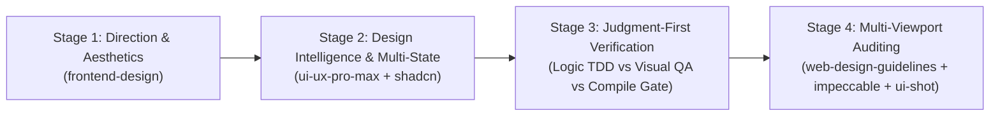
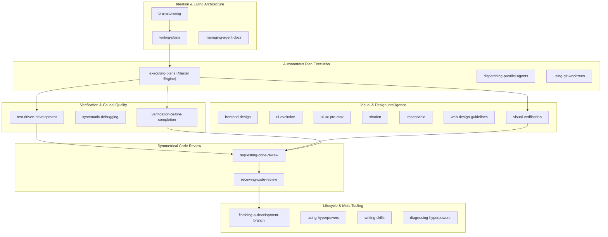

<p align="center">
  
</p>

<h1 align="center">Hyperpowers</h1>

<p align="center">
  <strong>The Next-Generation Full-Stack Agent Engineering & Visual Design Intelligence Framework</strong>
</p>

<p align="center">
  <a href="https://github.com/samwork64/hyperpowers/releases"></a>
  <a href="LICENSE"></a>
  <a href="#the-22-skill-suite"></a>
  <a href="#installation"></a>
  <a href="#the-zero-idle-subagent-invariant"></a>
</p>

---

## ⚡ What is Hyperpowers?

Most AI coding agents suffer from a catastrophic dual failure: **they write superficial code wrapped in test theater**, and **they produce visually generic, broken interfaces** littered with purple-to-cyan SaaS gradients and lucide-icon monocultures. Furthermore, when coordinating multi-step work, agents either dispatch subagents naively and sit completely idle waiting for them, or pollute contexts with thousands of lines of raw compiler output and stale documentation.

**Hyperpowers** is an industrial-grade agent engineering and visual intelligence framework that solves these structural flaws across all modern agent harnesses:

1. **Anti-Cliché Design Intelligence & UI Evolution**: Integrated 4-stage UI/UX pipeline backed by 79 searchable styles, 192 product palettes, 74 typography pairings, 119 UX guidelines, token harvesting (zero redundant CSS), and 5-axis 10/10 self-critiques (`ui-evolution`).
2. **Dual-Engine Visual Verification (`visual-verification`)**: Combines Mode A (Stateful Chrome DevTools interactive session with DOM automation and progressive capture) with Mode B (ephemeral, zero-leak multi-viewport audits via `ui-shot` across Mobile 375px, Tablet 768px, and Desktop 1280px in ~1.2s).
3. **Calibrated Criticality Gating (3 Blast-Radius Zones)**: Eliminates conversational friction for low-risk tweaks (Green Zone: instant execution, zero debate), enforces design token harvesting on visual updates (Yellow Zone: 10/10 critique), and demands independent architectural deliberation with $\ge 2$ alternatives on high-risk decisions (Red Zone).
4. **Independent Deliberation & Anti-Sycophancy**: Operates as an opinionated Principal Engineer. Replaces sycophantic flattery with evidence-based critiques and structured Micro-Justifications (<60 words) to prevent multi-turn transcript bloat.
5. **The Zero-Idle Subagent Invariant**: Strict prohibition against single-subagent sequential idling. Sequential tasks execute immediately inline; subagents are reserved strictly as concurrent throughput multipliers ($\ge 2$) for decoupled tasks.
6. **Master Plan Execution Engine**: Unified 3-mode execution (Hybrid, Sandboxed SDD, and Native Inline) with compaction recovery, disconnect revival, and watchdog protection.
7. **Living Subsystem Architecture (`agent-docs/`)**: Eliminates unmaintainable documentation sprawl by organizing architecture into compact subsystem briefs protected by Git Commit SHA drift detection and a managed ideas backlog.
8. **Token & Latency Hardening**: Plan atomicity caps (3–7 tasks), minimal context slicing (15–30 lines per subagent brief), 2-Failure circuit breakers against debugging thrashing, and targeted inner-loop test execution.

---

## 🚀 One-Command Installation

Hyperpowers can be installed directly from GitHub across all major agent platforms:

### 1. Google Antigravity (AGY)

Install directly via the official Antigravity CLI:

```bash
agy plugin install https://github.com/samwork64/hyperpowers
```

*Or instruct your agent directly in chat:*
> *"Install the Hyperpowers plugin from https://github.com/samwork64/hyperpowers and activate the full-stack engineering suite."*

Antigravity automatically discovers all 22 skills, configures the rules engine in `rules/AGENTS.md`, and activates `hyperpowers:using-hyperpowers` on session bootstrap.

---

### 2. Claude Code

Install via the plugin command:

```bash
claude plugin install https://github.com/samwork64/hyperpowers
```
*(Or inside an active session: `/plugin install https://github.com/samwork64/hyperpowers`)*

Claude Code seamlessly maps Hyperpowers workflows to native Plan Mode (`EnterPlanMode`/`ExitPlanMode`), `TodoWrite`/`TodoRead`, and concurrent `Agent` tool calls.

---

### 3. OpenAI Codex

In Codex App or CLI:
1. Open `/plugins` in your Codex terminal.
2. Select **Install from Git Repository** and provide:
   ```text
   https://github.com/samwork64/hyperpowers
   ```
Codex automatically enables `spawn_agent` V2 execution and `wait_agent` event subscriptions.

---

### 4. Cursor & Windsurf

Clone Hyperpowers into your global or project skills directory:

```bash
git clone https://github.com/samwork64/hyperpowers.git ~/.cursor/skills/hyperpowers
```
*(For Windsurf: clone into `~/.codeium/windsurf/skills/hyperpowers` or reference directly in `.windsurfrules`)*.

---

### 5. Gemini CLI & Copilot CLI

```bash
# Gemini CLI
gemini extensions install https://github.com/samwork64/hyperpowers

# GitHub Copilot CLI
copilot plugin install https://github.com/samwork64/hyperpowers
```

---

### 6. Universal Git Clone (Any Agent Harness)

For Devin, OpenCode, Qwen Code, Grok Build, Factory Droid, or custom local agents:

```bash
git clone https://github.com/samwork64/hyperpowers.git
```
Hyperpowers includes a **Universal Default Fallback** (`skills/using-hyperpowers/references/default-tools.md`) that executes seamlessly using standard POSIX shell commands, git worktrees, and markdown plan ledgers.

---

## 🎨 The 4-Stage Frontend UI/UX Pipeline

Whenever designing, modifying, or auditing user interfaces, Hyperpowers enforces a strict, four-stage design intelligence pipeline:



### Stage 1: Direction & Aesthetics (`hyperpowers:frontend-design`)
- **Ban AI Visual Clichés**: Strictly bans generic purple/indigo-to-cyan gradients (`from-indigo-500 to-teal-400`), the "Lucide-icon-in-a-gray-box" card monoculture, pastel "Trust-Me" badges, tracked-out ALL-CAPS eyebrow labels, and robotic buzz-copy (*"Streamline your workflow"*).
- **Domain Vernacular**: Ground aesthetics in the physical subject matter (retro consoles, financial terminals, Swiss editorial publishing, high-density developer CLIs).
- **Semantic Color Architecture**: Curate a deliberate 4–6 color palette using semantic theme tokens (`bg-background`, `text-foreground`, `border-border`, `bg-primary`). Never use washed-out low-contrast gray text (`text-slate-400` on white is banned).

### Stage 2: Design Intelligence & Multi-State Ergonomics (`ui-ux-pro-max` + `shadcn`)
- **Searchable Design Intelligence**: Access 79 active design styles, 192 product palettes, 74 font pairings, and 119 UX guidelines directly via `search.py`:
  ```bash
  python3 skills/ui-ux-pro-max/scripts/search.py "fintech dashboard" --design-system
  ```
- **Mandatory 4-State Coverage**: Never design only the happy path:
  - *Empty State*: Context-rich illustration/copy + prominent action CTA.
  - *Loading State*: Layout-accurate skeleton loader matching real geometry (no generic spinners).
  - *Error State*: Plain-English explanation + actionable retry button.
  - *Interaction States*: Distinct hover, active, disabled, and high-visibility `:focus-visible` rings for WCAG accessibility.
- **Component Composition**: Scaffold accessible, themeable components with `shadcn` (`npx shadcn@latest add`) rather than reinventing primitive UI from scratch.

### Stage 3: Judgment-First Verification (Anti-Test-Theater Gate)
- **Dynamic Logic & Contracts (TDD)** (`hyperpowers:test-driven-development`): Apply strict Red-Green-Refactor to functions that compute, transform schemas, serialize parameters, or manage state. Test the real contract: boundary cases, encoding, and schema conformity.
- **Visual Layout & Responsive Flow (Visual QA)**: Apply empirical screenshot verification via `ui-shot.cjs`. Unit tests that merely assert static DOM nodes or text exist are **strictly banned as test theater**.
- **Static URLs & Copy (Compile Gate)**: Zero unit tests needed. Verify static link reachability (`curl -sI`) and run compiler/typecheck passes (`tsc --noEmit`, `py_compile`, `eslint`).

### Stage 4: Multi-Viewport Visual Auditing & Craft Polish (`visual-verification` + `impeccable`)
- **The Multi-Viewport Gate**: Run `ui-shot` to inspect real layout across breakpoints:
  - **Mobile (375px)**: Check touch target sizes ($\ge 44 \times 44\text{px}$), zero horizontal overflow, clean column stacking, and no clipped text.
  - **Tablet (768px)**: Check navigation collapse, grid wrapping, and layout transitions.
  - **Desktop (1280px+)**: Check max-width constraints, optical balance, whitespace rhythm, and typography scale.
- **Interactive Staging & Scrolled Auditing**:
  ```bash
  # Full-page capture:
  node skills/visual-verification/scripts/ui-shot.cjs --full-page http://localhost:3000 ./screenshots/fullpage.png

  # Deep scroll targeting:
  node skills/visual-verification/scripts/ui-shot.cjs --scroll "#pricing" http://localhost:3000 ./screenshots/pricing.png

  # Stage UI state via DOM execution:
  node skills/visual-verification/scripts/ui-shot.cjs --eval 'document.querySelector("#theme-toggle").click()' http://localhost:3000 ./screenshots/dark.png
  ```
- **Console Hygiene**: Actively verify zero unhandled console warnings, runtime errors, or React hydration mismatches.

---

## 🛠️ The Complete 22-Skill Suite

Hyperpowers delivers 22 fully integrated, orthogonal skills organized into six functional pillars:



| Pillar | Skill | Purpose & Core Invariant |
| :--- | :--- | :--- |
| **Visual Experience** | [`frontend-design`](skills/frontend-design/SKILL.md) | Tailored typography, domain-anchored aesthetics, 4-state coverage, ban AI visual clichés. |
| **Visual Experience** | [`ui-evolution`](skills/ui-evolution/SKILL.md) | Token harvesting (zero redundant CSS), visual forensics, 10/10 self-critique with mockups. |
| **Visual Experience** | [`ui-ux-pro-max`](skills/ui-ux-pro-max/SKILL.md) | Searchable local database: 79 styles, 192 product palettes, 74 font pairings, 119 UX guidelines. |
| **Visual Experience** | [`shadcn`](skills/shadcn/SKILL.md) | Component composition, preset registry, design system architecture (`npx shadcn@latest add`). |
| **Visual Experience** | [`impeccable`](skills/impeccable/SKILL.md) | Out-of-distribution craft floor, surface modes (*Operate*, *Read*, *Persuade*), tactile physics. |
| **Visual Experience** | [`web-design-guidelines`](skills/web-design-guidelines/SKILL.md) | Vercel guidelines audit: tap targets ($\ge 44\times 44$px), keyboard navigation, WCAG AA compliance. |
| **Visual Experience** | [`visual-verification`](skills/visual-verification/SKILL.md) | Dual-Engine QA: Chrome DevTools interactive automation + headless `ui-shot` multi-viewport. |
| **Autonomous Execution** | [`executing-plans`](skills/executing-plans/SKILL.md) | **Master Execution Engine**: Mode 1: Hybrid (default), Mode 2: Sandboxed SDD, Mode 3: Native Inline. |
| **Autonomous Execution** | [`dispatching-parallel-agents`](skills/dispatching-parallel-agents/SKILL.md) | Orthogonal task parallelism: concurrent batch dispatch for decoupled dependency branches. |
| **Autonomous Execution** | [`using-git-worktrees`](skills/using-git-worktrees/SKILL.md) | Isolated workspace creation on fresh branches to protect current working tree. |
| **Causal Quality** | [`test-driven-development`](skills/test-driven-development/SKILL.md) | RED-GREEN-REFACTOR cycle for dynamic logic and contracts. Targeted inner-loop test execution. |
| **Causal Quality** | [`systematic-debugging`](skills/systematic-debugging/SKILL.md) | Causal root isolation, falsifiable hypotheses, test-polluter isolation, 2-Failure circuit breaker. |
| **Causal Quality** | [`verification-before-completion`](skills/verification-before-completion/SKILL.md) | Demand fresh empirical evidence across full domain matrix before making completion claims. |
| **Symmetrical Review** | [`requesting-code-review`](skills/requesting-code-review/SKILL.md) | 6-axis audit against `code-review-rubric.md`. Fast inline self-review by default. |
| **Symmetrical Review** | [`receiving-code-review`](skills/receiving-code-review/SKILL.md) | 4-quadrant technical deliberation over performative agreement. Push back on hallucinated feedback. |
| **Ideation & Architecture** | [`brainstorming`](skills/brainstorming/SKILL.md) | Socratic intent discovery before coding. Lead with engineering trade-offs; capture ideas to `ideas.md`. |
| **Ideation & Architecture** | [`writing-plans`](skills/writing-plans/SKILL.md) | Atomic plans capped at 3–7 tasks. Phase splitting for large features. Reject plan dumping in chat. |
| **Ideation & Architecture** | [`managing-agent-docs`](skills/managing-agent-docs/SKILL.md) | Living subsystem briefs in `agent-docs/modules/`, Git commit SHA drift guard, active ideas backlog. |
| **Lifecycle & Meta** | [`finishing-a-development-branch`](skills/finishing-a-development-branch/SKILL.md) | Clean tree verification, idea backlog reconciliation, SHA updates, structured merge/PR creation. |
| **Lifecycle & Meta** | [`using-hyperpowers`](skills/using-hyperpowers/SKILL.md) | Universal prompt triage router (5 categories), criticality gating, and tool resolution. |
| **Lifecycle & Meta** | [`writing-skills`](skills/writing-skills/SKILL.md) | Test-driven skill design, YAML frontmatter conformance, subagent verification. |
| **Lifecycle & Meta** | [`diagnosing-hyperpowers`](skills/diagnosing-hyperpowers/SKILL.md) | Objective transcript log forensics, line-level evidence collection, diagnostic reporting. |

---

## 🎯 Calibrated Criticality Gating & Anti-Sycophancy

AI coding models naturally suffer from RLHF sycophancy—they passively execute flawed user requests, duplicate existing CSS, and fail to question architectural consequences. When told to "deliberate", they often over-correct into conversational friction (debating simple color tweaks).

Hyperpowers resolves this with **Calibrated Criticality Gating (3 Blast-Radius Zones)**:

```
┌────────────────────────────────────────────────────────────────────────┐
│                        Incoming User Prompt                            │
└───────────────────────────────────┬────────────────────────────────────┘
                                    │
          ┌─────────────────────────┼─────────────────────────┐
          ▼                         ▼                         ▼
   [Green Zone: Low-Risk]    [Yellow Zone: UI/Component]   [Red Zone: Architectural]
   • Explicit value tweaks   • Visual redesigns            • Schema, state, auth
   • Typos, formatting       • Styling & interactions      • Greenfield features
   ─────────────────────     ────────────────────────      ─────────────────────────
   Action:                   Action:                       Action:
   Execute immediately with  Audit existing CSS/tokens;    Compare ≥2 alternatives;
   verification. ZERO debate. 5-axis 10/10 rating;        lead with recommendation
                             state 2-line trade-off.       & trade-offs upfront.
```

- **Green Zone (Tactical / Low-Risk)**: Direct, unambiguous requests (*"Change padding to 12px"*, *"Rename variable"*). **Action: Execute immediately with syntax/build verification. Zero debate or friction.**
- **Yellow Zone (UI & Component Evolution)**: Visual changes, modal refactors, new buttons. **Action: Audit codebase tokens first (*reuse first, extend second, invent never*), apply 5-axis 10/10 visual rating, and state a 2-line trade-off.**
- **Red Zone (System & Architectural Decisions)**: Data models, API contracts, major refactors, state architecture. **Action: Compare $\ge 2$ alternatives, lead with the recommended default and trade-offs upfront, then invite user alignment.**

### The Micro-Justification Schema (<60 Words)
To prevent the agent from bloating chat context history with long-winded essays, all technical rationale must adhere to the high-density **Micro-Justification Schema**:
```markdown
- **Verdict**: [Optimal / Suboptimal / Duplicative]
- **Why & Trade-offs**: [1-2 lines citing empirical facts: reusability, performance, or WCAG]
- **Recommended Default**: [The opinionated path forward]
```

---

## ⚡ The Zero-Idle Subagent Invariant

In standard agent harnesses, a severe performance and cost anti-pattern is dispatching a single subagent for a sequential step, causing the primary coordinator agent to sit completely idle waiting for it.

Hyperpowers strictly enforces the **Zero-Idle Invariant**:

```
BANNED: Dispatching 1 subagent for a sequential task and sitting idle.
```

- **Rule 1: Inline First**: If a task is sequential, execute it directly in the parent session. Inline execution provides immediate feedback, zero spin-up latency, and zero token waste.
- **Rule 2: True Concurrency ($\ge 2$)**: Subagents are reserved strictly as throughput multipliers for concurrent batches touching disjoint files (`Subagents: [...]`), or heavy non-blocking background delegation.
- **Rule 3: Fast Inline Review**: Coordinators review diffs inline against [`code-review-rubric.md`](skills/requesting-code-review/code-review-rubric.md) in seconds rather than launching another idle subagent reviewer.

---

## 🛡️ Token, Latency & Anti-Thrashing Safeguards

Hyperpowers is engineered to protect context windows and prevent runaway agent thrashing:

1. **Targeted Test Inner Loop**: During the TDD cycle (RED-GREEN-REFACTOR), agents execute **only the targeted test file** covering the active code. Running entire multi-module test suites on every line edit is banned, eliminating 80–90% of cycle latency.
2. **Plan Atomicity & Task Cap**: Implementation plans are hard-capped at **3 to 7 atomic tasks**. Monolithic mega-plans (>8 tasks) exhaust context windows and cause compounding drift. Large features must be split into phased milestones (`Phase 1: Backend`, `Phase 2: UI`).
3. **Minimal Context Slicing**: When dispatching implementers, coordinators slice and pass **only the 15–30 line task brief and interface contracts**. Pasting full 200+ line implementation plans into subagents is strictly banned.
4. **The 2-Failure Circuit Breaker**: If two consecutive fix attempts fail to resolve a bug or cause secondary regressions, agents **must stop immediately**, run `git checkout -- .` to restore a clean baseline, and re-trace signal paths or consult telemetry rather than guessing.
5. **Log Output Density Guard**: Raw verbose build logs (1,000+ lines of compiler stdout) are prevented from flooding context. Agents use quiet flags (`pytest -q`, `cargo test -- -q`) and surgical error tail inspection (`tail -n 50`).
6. **Compressed Frontmatter Metadata**: All 22 skill descriptions are compressed to high-density intent triggers, saving **~250 tokens per turn** on every prompt invocation.
7. **File-Level Syntax Sanity Gate (`check-syntax.py`)**: Before claiming completion or declaring "good to go", agents execute a $<100\text{ms}$ static parse across all modified files (`ast.parse`, `json.loads`, `node --check`, `bash -n`, TOML, YAML). This prevents common failures where focused test suites pass on module A while an un-imported module B or config file harbors a silent syntax error.

---

## 📚 Living Subsystem Architecture (`agent-docs/`)

Hyperpowers rejects both extremes of documentation: bloated unread wikis and missing architectural context. It maintains a **living subsystem topology**:

```
agent-docs/
├── architecture.md          # Global tech stack, entry points, directory map (<60 lines)
├── ideas.md                 # Managed active backlog (auto-reconciled on branch completion)
└── modules/
    ├── auth.md              # Subsystem brief: contracts, invariants, gotchas
    ├── billing.md           # Tracked paths: src/billing/**, verified commit SHA
    └── api-gateway.md       # Empirical drift check: git diff <SHA>..HEAD -- <paths>
```

- **Git Commit SHA Drift Detection**: Every subsystem brief records `Verified Commit: <git-sha>`. Before trusting documented contracts, agents run:
  ```bash
  git diff --name-only <VERIFIED_COMMIT>..HEAD -- <TRACKED_SOURCE_PATHS>
  ```
  If deltas exist, the brief is refreshed opportunistically before proceeding.
- **Active Ideas Lifecycle**: Emerging ideas captured during brainstorming or reviews are ledgered in `agent-docs/ideas.md`. Upon branch finalization (`finishing-a-development-branch`), implemented or superseded ideas are automatically pruned to prevent context bloat.

---

## 🔬 Dual-Engine Visual Verification (`visual-verification`)

Hyperpowers implements a dual-engine visual verification architecture that combines stateful interactive browser automation with zero-leak responsive auditing:

### Mode A: Stateful Interactive Automation (Chrome DevTools / CDP)
For multi-step interactive workflows (modals, drawers, multi-field forms, responsive navigation menus, active interaction states):
- **Single Warm Session**: Maintains 1 headless Chrome DevTools session across steps to inspect live DOM nodes, trigger events, verify computed CSS, and capture progressive screenshots (`before-open.png`, `drawer-opened.png`, `form-submitted.png`).
- **Compulsory Session Teardown**: Mandates closing the page and terminating the browser process immediately upon test completion to guarantee zero background memory leaks.

### Mode B: Ephemeral Multi-Viewport Auditing (`ui-shot`)
For fast, zero-leak layout and responsive visual gates:
- **Zero External Dependencies**: Pure Node.js 18+ bundled at [`skills/visual-verification/scripts/ui-shot.cjs`](skills/visual-verification/scripts/ui-shot.cjs) utilizing native `fetch` and `WebSocket` communicating directly with Chrome/Edge DevTools Protocol (CDP).
- **Sub-Second Execution**: Launches lightweight `chrome-headless-shell` or headless browser, executes in ~1.2 seconds, and exits cleanly with 100% memory reclamation.
- **Multi-Viewport Standard**:
  ```bash
  node skills/visual-verification/scripts/ui-shot.cjs http://localhost:3000 ./screenshots
  # Automatically outputs:
  #   - preview-mobile.png   (375x667, @2x DPI)
  #   - preview-tablet.png   (768x1024, @2x DPI)
  #   - preview-desktop.png  (1280x800, @2x DPI)
  ```
- **Custom DOM Interaction & Raw CDP**:
  ```bash
  # Click buttons or fill inputs before capturing:
  node skills/visual-verification/scripts/ui-shot.cjs --eval 'document.querySelector("#menu-btn").click()' http://localhost:3000 ./screenshots

  # Send raw CDP commands:
  node skills/visual-verification/scripts/ui-shot.cjs --cdp 'Emulation.setEmulatedMedia:{"media":"print"}' http://localhost:3000 ./screenshots
  ```

---

## ⚙️ Configuration & Customization (`hyperpowers.json`)

Hyperpowers works immediately out-of-the-box with production-hardened defaults. When projects require custom task caps, alternative execution modes, or custom viewport dimensions, Hyperpowers provides hierarchical configuration through **JSON schema**, **environment variables**, and **natural language chat prompting**.

### 1. Natural Language Prompting (Agent-Driven)

You can adjust settings at any time simply by asking your agent in natural language:
- *"Set execution mode to inline for this project"*
- *"Increase implementation plan task cap to 10"*
- *"Set the debugging circuit breaker to 3 attempts"*
- *"Change the mobile preview viewport to 414x896"*

The agent will automatically create or update `hyperpowers.json` adhering to [`hyperpowers.schema.json`](hyperpowers.schema.json) and confirm the changes.

---

### 2. Configuration File (`hyperpowers.json`)

Create a `hyperpowers.json` (or `.hyperpowers/config.json`) in your project root:

```json
{
  "$schema": "https://raw.githubusercontent.com/samwork64/hyperpowers/main/hyperpowers.schema.json",
  "execution": {
    "mode": "hybrid",
    "taskCap": 7,
    "watchdogTimeoutSeconds": 450
  },
  "debugging": {
    "circuitBreakerThreshold": 2
  },
  "testing": {
    "targetedInnerLoop": true,
    "quietByDefault": true
  },
  "visual": {
    "viewports": {
      "mobile": { "width": 375, "height": 812 },
      "tablet": { "width": 768, "height": 1024 },
      "desktop": { "width": 1440, "height": 900 }
    },
    "timeoutMs": 12000
  },
  "telemetry": false
}
```

#### Settings Reference

| Key | Type | Default | Description |
| :--- | :--- | :--- | :--- |
| `execution.mode` | `"hybrid"` \| `"sdd"` \| `"inline"` | `"hybrid"` | Plan execution engine mode. `"hybrid"` executes sequential tasks inline and independent batches concurrently; `"sdd"` isolates every task in a subagent; `"inline"` runs all tasks sequentially in the active session. |
| `execution.taskCap` | `integer (1–20)` | `7` | Maximum atomic tasks in a plan before milestone phase-splitting. |
| `execution.watchdogTimeoutSeconds` | `integer (30–1800)` | `450` | Liveness watchdog interval before inspecting background tasks. |
| `debugging.circuitBreakerThreshold` | `integer (1–5)` | `2` | Number of consecutive failed bug-fix attempts before halting speculative edits. |
| `testing.targetedInnerLoop` | `boolean` | `true` | Restrict inner TDD test cycle to active test file, eliminating regression test lag. |
| `testing.quietByDefault` | `boolean` | `true` | Apply quiet flags (`-q`) to prevent log floods in context windows. |
| `visual.viewports` | `object` | *See above* | Custom dimensions for `mobile`, `tablet`, and `desktop` captures in `ui-shot.cjs`. |
| `visual.timeoutMs` | `integer` | `12000` | Multi-viewport page readiness timeout in milliseconds. |
| `telemetry` | `boolean` | `false` | Enable or disable external companion badge requests. |

---

### 3. Resolution Precedence

Settings resolve dynamically in the following order:

$$\text{Environment Variables} \longrightarrow \text{Project } \texttt{hyperpowers.json} \longrightarrow \text{Global } \texttt{\~/.config/hyperpowers/config.json} \longrightarrow \text{Built-in Defaults}$$

| Setting | Environment Variable Override |
| :--- | :--- |
| `execution.mode` | `HYPERPOWERS_EXECUTION_MODE="hybrid"\|"sdd"\|"inline"` |
| `execution.taskCap` | `HYPERPOWERS_TASK_CAP=7` |
| `debugging.circuitBreakerThreshold` | `HYPERPOWERS_CIRCUIT_BREAKER=2` |
| `telemetry` | `HYPERPOWERS_DISABLE_TELEMETRY=1` |

---

## 🔒 Privacy & Telemetry

Hyperpowers is committed to developer privacy:
- Zero telemetry or analytics are collected during normal skill execution, test running, or plan execution.
- The optional visual brainstorming companion loads a local or minimal badge indicating version information.
- To disable all external network calls:
  ```bash
  export HYPERPOWERS_DISABLE_TELEMETRY=1
  ```
- Hyperpowers also respects `DISABLE_TELEMETRY=1` and `CLAUDE_CODE_DISABLE_NONESSENTIAL_TRAFFIC=1`.

---

## 📄 Lineage & License

Hyperpowers evolves and synthesizes the engineering discipline of the Superpowers methodology originally created by [Jesse Vincent](https://blog.fsck.com) and [Prime Radiant](https://primeradiant.com).

Released under the **[MIT License](LICENSE)**.

```
Copyright (c) 2026 samwork64 & Hyperpowers Contributors
```
