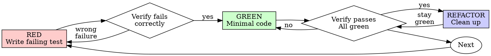

# Test-Driven Development (TDD) & Verification Judgment

## Overview

Test-Driven Development is an engineering discipline for designing and verifying **behavior, contracts, dynamic logic, and state transitions**. 

Write the test first. Watch it fail. Write minimal code to pass.

**Core Principle**: A test is only valuable if it verifies real behavior and guards against actual failure modes. If a test does not test dynamic behavior or contracts, writing it is **test theater**.

---

## 1. The Judgment-First Framework: Assessing the Failure Mode

Before writing code or tests, evaluate the change against three fundamental questions:

### Question 1: What is the real failure mode here?
* **Algorithmic / Behavioral**: The code computes values, formats data, transforms schemas, manages state, or implements branching logic (e.g., a URL generator building query strings from dynamic parameters).
  $\rightarrow$ **Right Tool**: **Unit / Integration Test (TDD)**. Test input variations, edge cases (empty strings, special characters), and contract validity.
* **Visual / Layout / Responsive**: The change is about CSS, spacing, alignment, typography, colors, or mobile breakpoints.
  $\rightarrow$ **Right Tool**: **Visual & Multi-Viewport Verification (`ui-shot`)**. Unit tests cannot see clipped text, overflowing boxes, or broken layouts. Inspect real viewports at 375px, 768px, and 1440px.
* **Endpoint / Link Integrity**: A link or URL was updated or added.
  $\rightarrow$ **Right Tool**: **HTTP / Live Verification**. Testing whether `href === "url"` is tautological theater; testing that the URL actually responds with HTTP 200 or returns expected schema data is what matters.
* **Syntax / Imports / Types**: The change is a typo fix, configuration update, or minor copy tweak.
  $\rightarrow$ **Right Tool**: **Compiler, Type-Checker & Linter** (`tsc --noEmit`, `eslint`, `python -m py_compile`). Unit tests are completely redundant here.

### Question 2: Does a unit test provide real engineering value or is it test theater?
* **Test Theater**: A test that simply repeats the source code in a second file without exercising logic (e.g., asserting that a static string constant equals that string, or that a button has label "Submit"). **Reject test theater.**
* **Real Engineering Value**: A test that proves a contract, tests branching logic, protects against regression during refactoring, or catches boundary edge cases.

### Question 3: What is the most effective verification combination?
Choose the verification strategy that matches the risk. For example:
* *Dynamic URL Generator*: Unit tests for parameter encoding + live check that the target endpoint accepts the query.
* *Interactive UI Component*: Logic test for state/event dispatch + visual `ui-shot` check for layout.
* *Static Content / Documentation Link*: Syntax/compile check + HTTP link check.

---

## 2. When TDD Applies (and When It Does Not)

### Apply TDD For:
- **Dynamic Logic & Transformations**: URL generators, query string builders, data parsers, mappers.
- **State Management**: Redux/Zustand stores, reducers, state machines, custom hooks.
- **Contract & API Handlers**: Request parsers, response formatters, authentication guards, route handlers.
- **Calculations & Algorithms**: Filtering algorithms, pricing calculators, pagination logic.
- **Bug Fixes in Business Logic**: Reproduce the logic bug with a failing test first, then fix the code.

### Do NOT Write Unit Tests For (Anti-Patterns):
- **Static URLs & Constants**: Do not test that a constant equals its value.
- **Static UI Markup & Labels**: Do not test that static text or icons exist in the DOM.
- **Pure CSS / Tailwind Presentation**: Do not write tests asserting CSS class names or styles; verify visually with `ui-shot`.
- **Configuration & Environment Files**: Verify via schema validation or compilation, not unit tests.

---

## 3. The Red-Green-Refactor Cycle (For Logic & Contracts)

When a test is warranted, follow the strict cycle:



### RED: Write One Minimal Failing Test
Demonstrate the contract: what inputs go in, what output comes out, or how an edge case behaves.

```typescript
// Example: Testing a dynamic URL generator
test('generates valid catalog search URL with encoded parameters', () => {
  const url = buildCatalogUrl({ system: 'snes', search: 'super mario & friends', page: 2 });
  expect(url).toBe('/api/catalog?system=snes&search=super%20mario%20%26%20friends&page=2');
});

test('omits undefined or empty search parameters from catalog URL', () => {
  const url = buildCatalogUrl({ system: 'snes', search: '' });
  expect(url).toBe('/api/catalog?system=snes');
});
```

### Verify RED: Confirm It Fails For the Right Reason
Run the test runner (`pytest`, `npm test`, etc.). Confirm it fails because the feature or logic is missing, not because of an import error or typo.

### GREEN: Implement the Minimal Code
Write just enough code to satisfy the test contract. Do not add speculative features or premature abstractions.

### Verify GREEN: Confirm Test Passes
Run the test runner and verify it passes cleanly.

### REFACTOR: Clean Up
Remove duplication, improve variable names, or optimize performance while keeping the test suite green.

---

## 4. The Universal Invariant: The Build & Syntax Gate

Regardless of whether a task is verified via TDD, visual verification, or link checks:

**EVERY code change must pass static analysis and compilation before being declared complete:**
* Type checks: `npx tsc --noEmit` or language equivalent.
* Syntax / Lint checks: `npm run lint`, `eslint`, or `python3 -m py_compile`.
* Full Suite Regressions: Ensure the broader test suite remains green.
